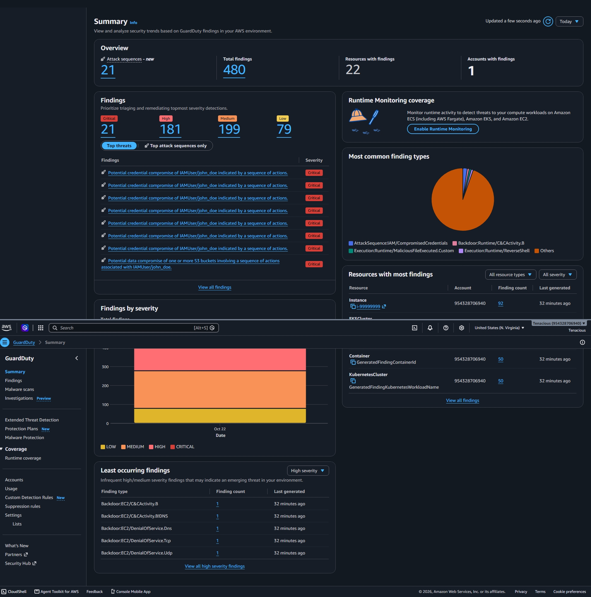
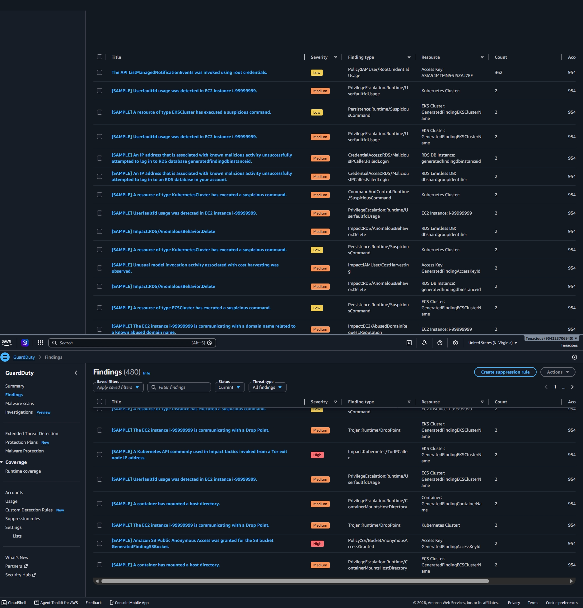
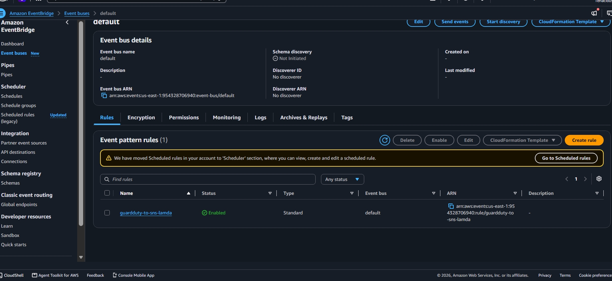
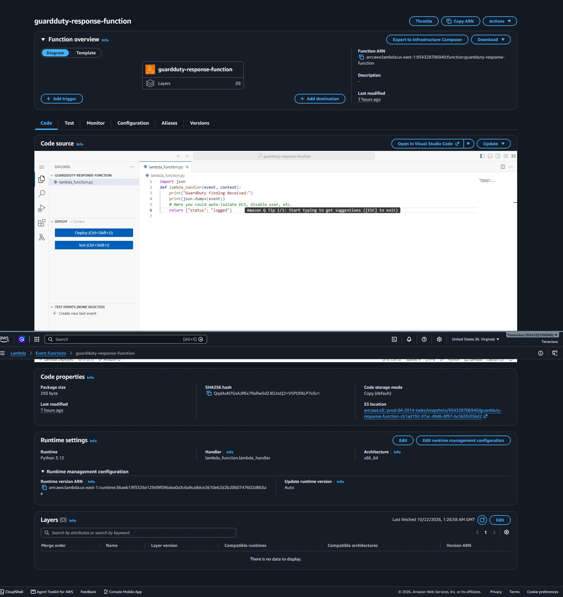
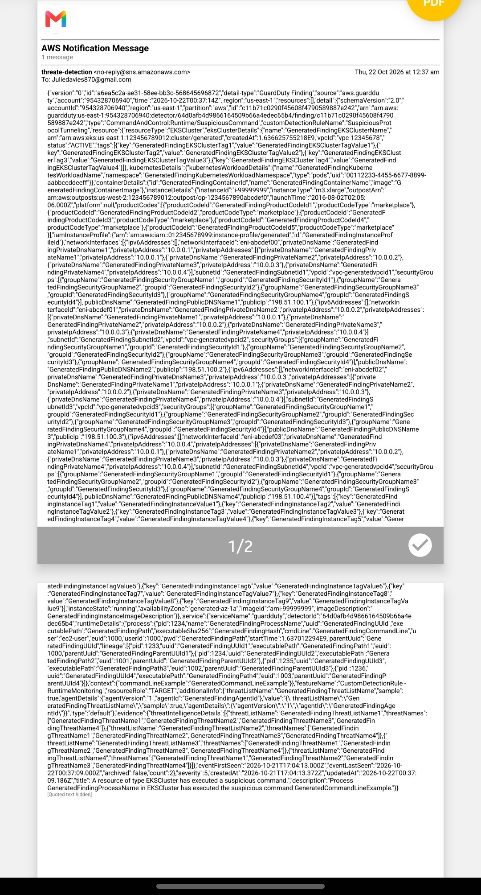
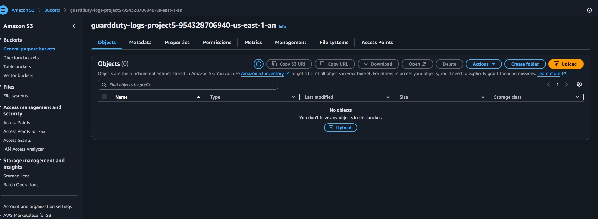
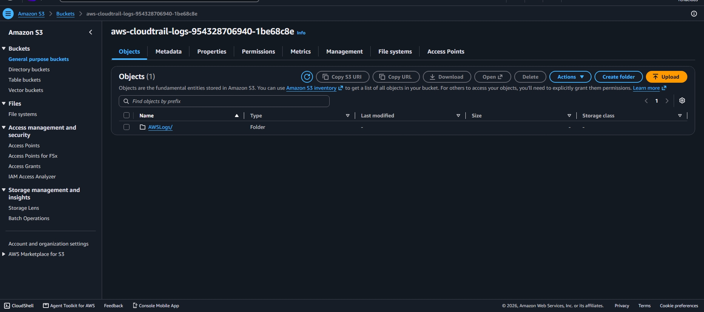

# AWS GuardDuty Automated Threat Detection Pipeline

Automated pipeline that detects, routes, and alerts on AWS threats in real-time.

## Architecture
**GuardDuty (480 sample findings) -> EventBridge Rule (Enabled) -> Lambda `guardduty-response-function` + SNS -> Gmail + S3 Archiving**

- **Region:** us-east-1
- **Account:** 954328706940 (verified in logs)
- **Buckets:** `guardduty-logs-project5-954328706940-us-east-1-an`

## Code
- `lambda_function.py` - Parses GuardDuty finding, publishes to SNS
- `Eventbridge-rule.json` - `source: aws.guardduty`

## Proof Screenshots

### 1. GuardDuty Summary (480 findings)

### 2. GuardDuty Findings

### 3. EventBridge Rule (ENABLED)

### 4. Lambda Function

### 5. Email Alert Proof

### 6. S3 Archiving

## Cost Control
Disabled GuardDuty detector after proof. Lambda, SNS, S3 free tier = $0.

**Built:** Oct 21, 2026 by Simon Kofi Duku
